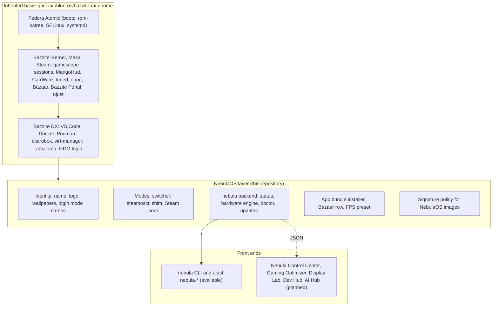
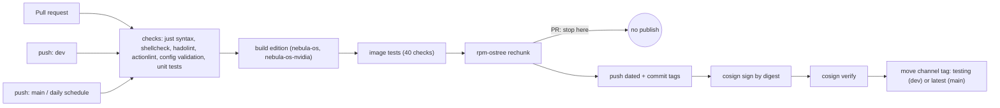
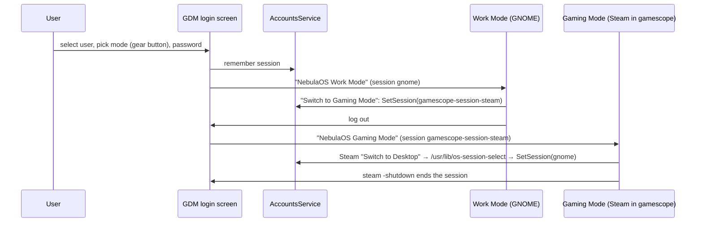

# NebulaOS architecture

NebulaOS is an image-based (atomic) Linux distribution. The whole operating system is one OCI container image built on top of Bazzite DX, published to a registry, and installed and updated as a unit by bootc and rpm-ostree.

## Layers



NebulaOS changes the base only through:

- files copied from `system_files/` (new files; any file that replaces a base file is listed in the build log), and
- the numbered build steps in `build_files/`, which degrade gracefully (skip with a note) when a Bazzite file they adjust has changed shape.

## Build and release pipeline



- Base images: `bazzite-dx-gnome:stable` (AMD/Intel) and `bazzite-dx-nvidia-gnome:stable` (NVIDIA). The resolved base digest is recorded in image labels and `/usr/share/nebula-os/build-info.json`.
- A weekly Trivy scan uploads results to the repository's Security tab and keeps a CycloneDX SBOM.
- Disk images (ISO and qcow2) are built on demand with bootc-image-builder.

## Runtime

### The two modes



- Session IDs stay Bazzite's; only the names on the login screen change.
- Everything goes through AccountsService. A user may change their own session preference without a password (polkit `change-own-user-data`), so no privileged helper is needed.
- `/usr/bin/steamosctl` is a NebulaOS compatibility shim, installed only when the base has none, so Bazzite's own buttons and `ujust` recipes keep working on GDM.

### The `nebula` backend

```
/usr/bin/nebula                        launcher (python3 -I, standard library only)
/usr/lib/nebula-os/nebula/
  sysinfo.py       CPU, memory, storage, network, temperatures, power profile, OS and build info
  gpu.py           GPU detection + AMD / Intel / NVIDIA / generic backends (one interface)
  display.py       connectors, EDID decoder, GNOME (Mutter) display state, VRR and HDR capabilities
  capabilities.py  the five-level capability model
  hardware.py      the full hardware report and compatibility notes
  doctor.py        System Doctor checks
  updates.py       deployments, update check, apply and rollback with confirmation
  cli.py           text and --json output
```

Rules every module follows:

1. **Real data only.** Values come from `/proc`, `/sys`, systemd, rpm-ostree, Mutter (D-Bus), EDID and driver tools. Anything that cannot be read is `null`, never guessed.
2. **No accidental wake-ups.** A runtime-suspended GPU (typical for a laptop's dedicated GPU) is not touched for monitoring. Vulkan, OpenGL and VA-API probes, which do wake GPUs, run only for the explicit hardware report.
3. **Unprivileged.** Reading needs no root. The only actions that change the system (`nebula update apply` and `rollback`) ask for confirmation, then hand over to rpm-ostree, which asks for authentication through polkit.
4. **Safe subprocesses.** Commands run without a shell, with a timeout, no stdin and the C locale.

### The capability model

Every capability (Vulkan, OpenGL, VA-API, GPU power management, VRR, HDR, …) is reported at five separate levels, never as a plain "supported":

| Level | Meaning | Example evidence |
| --- | --- | --- |
| hardware | The hardware can do it | EDID Adaptive-Sync range 60–165 Hz |
| driver | A driver or stack is installed and loaded | Vulkan ICD present, kernel driver bound |
| available | The system exposes it now | GNOME offers variable refresh modes |
| enabled | It is switched on | The current mode uses variable refresh |
| verified | It was exercised and worked | `vulkaninfo` enumerated the device, `vainfo` listed codecs |

Each level is `true`, `false` or `null` (unknown) with evidence. Front ends show, for example, "available, turned off" instead of a misleading "supported".

### Updates and recovery

- `uupd` (inherited) checks and applies updates automatically. The new deployment takes effect at the next restart.
- The previous deployment stays in the boot menu. `sudo bootc rollback` or `nebula update rollback` makes it the default again.
- With `ujust nebula-enable-signed-updates`, the system follows `ostree-image-signed:docker://ghcr.io/<owner>/nebula-os:<channel>` and rejects images that are not signed with the NebulaOS key (`/etc/pki/containers/nebula-os.pub`).

## Data and privacy

NebulaOS sends no telemetry. The only network requests made by NebulaOS code are:

- the update check (`nebula update check`) to the image registry,
- the Flatpak installs of the app bundle from Flathub, and
- a DNS lookup of the registry name in `nebula doctor`.

The Doctor report file contains the error log only with `--include-logs`, and is written with mode 0600.
