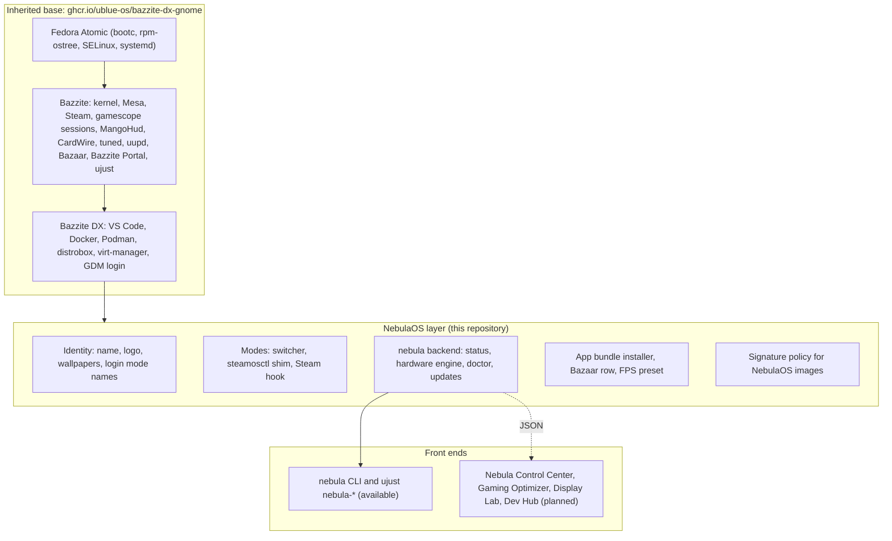
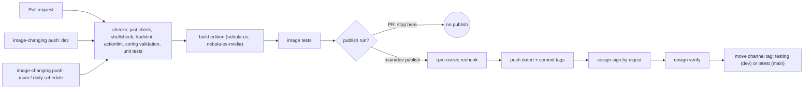

# NebulaOS architecture

NebulaOS is an image-based (atomic) Linux distribution. The whole operating system is one OCI container image built on top of Bazzite DX, published to a registry, and installed and updated as a unit by bootc and rpm-ostree.

## Layers



NebulaOS changes the base only through:

- files copied from `system_files/` (new files; any file that replaces a base file is listed in the build log), and
- the numbered build steps in `build_files/`, which degrade gracefully (skip with a note) when a Bazzite file they adjust has changed shape.

## Build and release pipeline



- Base images: `bazzite-dx-gnome:stable` (AMD/Intel) and `bazzite-dx-nvidia-gnome:stable` (NVIDIA). The resolved base digest is recorded in image labels and `/usr/share/nebula-os/build-info.json`.
- Pushes that change only Markdown or files under `docs/` are ignored. Pull requests still build and test images but stop before publishing; a manual workflow run on `main` or `dev` publishes to that branch's channel.
- A weekly Trivy scan uploads results to the repository's Security tab and keeps a CycloneDX SBOM.
- Disk images (ISO and qcow2) are built on demand with bootc-image-builder.

## Runtime

### The two modes

```mermaid
sequenceDiagram
    participant U as User
    participant G as GDM login screen
    participant A as AccountsService
    participant P as Per-user mode state
    participant C as NebulaOS wrapper and chooser
    participant W as Work Mode (GNOME)
    participant S as Gaming Mode (Steam in gamescope)
    U->>G: select user and sign in
    alt chooser session selected
        G->>C: start nebula-os session
        C->>U: show Gaming, Work and power choices
        U->>C: choose a mode
        alt Work Mode
            C->>W: start GNOME session command
        else Gaming Mode
            C->>S: start gamescope-session-plus command
        end
    else direct session selected from the gear menu
        G->>A: remember gnome or gamescope-session-steam
        alt Work Mode
            G->>W: start Work Mode
        else Gaming Mode
            G->>S: start Gaming Mode
        end
    end
    W->>P: switch request writes a one-time next-mode choice
    S->>P: Steam Switch to Desktop writes a one-time Work choice
    P->>C: selected mode exits; wrapper starts the requested mode
    C->>G: logout returns to the login screen
```

New accounts use the full-screen chooser by default. `ujust nebula-mode chooser` enables it for an account with a saved session. `ujust nebula-mode chooser-off` selects the last mode chosen through the chooser, or Work Mode if there is no saved choice. The gear menu on GDM remains available for direct access to the Bazzite sessions.

When the chooser starts a mode, the wrapper reads that mode's `.desktop` entry, exports its desktop variables and imports the selected desktop names into the systemd user manager. It clears stale display variables and portal services before each handoff. The chooser runs in Cage with GTK portal startup disabled; when it exits, the selected GNOME or gamescope session command starts in the same login. The logind `Desktop` property and D-Bus restart timing still need verification in a booted image; see [the gaming audit](BACKEND_GAMING_AUDIT.md#full-screen-chooser-handoff-not-verified-in-a-booted-image).

Direct GDM logins use the original Bazzite session IDs; only the displayed names change. With the chooser enabled, switching modes from inside a mode writes a one-time choice and exits that mode so the wrapper can start the other one without a new login. A user may change their saved session without a password through AccountsService (polkit `change-own-user-data`). `/usr/bin/steamosctl` is a NebulaOS compatibility shim only when the base image does not provide its own binary.

### The `nebula` backend

```
/usr/bin/nebula                        launcher (python3 -I, standard library only)
/usr/lib/nebula-os/nebula/
  sysinfo.py       CPU, memory, storage, network, temperatures, power profile, OS and build info
  gpu.py           GPU detection + AMD / Intel / NVIDIA / generic backends (one interface)
  display.py       connectors, EDID decoder, GNOME (Mutter) display state, VRR and HDR capabilities
  capabilities.py  the five-level capability model
  hardware.py      the full hardware report and compatibility notes
  doctor.py        System Doctor checks
  updates.py       deployments, update check, apply and rollback with confirmation
  cli.py           text output; --json for status, hw, doctor, update check and update history
```

Rules every module follows:

1. **Real data only.** Values come from `/proc`, `/sys`, systemd, rpm-ostree, Mutter (D-Bus), EDID and driver tools. Anything that cannot be read is `null`, never guessed.
2. **No accidental wake-ups.** A runtime-suspended GPU (typical for a laptop's dedicated GPU) is not touched for monitoring. Vulkan, OpenGL and VA-API probes, which do wake GPUs, run only for the explicit hardware report.
3. **Unprivileged.** Reading needs no root. The only actions that change the system (`nebula update apply` and `rollback`) ask for confirmation, then hand over to rpm-ostree, which asks for authentication through polkit.
4. **Safe subprocesses.** Commands run without a shell, with a timeout, no stdin and the C locale.

### The capability model

Every capability (Vulkan, OpenGL, VA-API, GPU power management, VRR, HDR, …) is reported at five separate levels, never as a plain "supported":

| Level | Meaning | Example evidence |
| --- | --- | --- |
| hardware | The hardware can do it | EDID Adaptive-Sync range 60–165 Hz |
| driver | A driver or stack is installed and loaded | Vulkan ICD present, kernel driver bound |
| available | The system exposes it now | GNOME offers variable refresh modes |
| enabled | It is switched on | The current mode uses variable refresh |
| verified | It was exercised and worked | `vulkaninfo` enumerated the device, `vainfo` listed codecs |

Each level is `true`, `false` or `null` (unknown) with evidence. Front ends show, for example, "available, turned off" instead of a misleading "supported".

### Updates and recovery

- `uupd` (inherited) checks and applies updates automatically. The new deployment takes effect at the next restart.
- The previous deployment stays in the boot menu. `sudo bootc rollback` or `nebula update rollback` makes it the default for the next restart; restart to boot it.
- With `ujust nebula-enable-signed-updates`, the system follows `ostree-image-signed:docker://ghcr.io/<owner>/nebula-os:<channel>` and rejects images that are not signed with the NebulaOS key (`/etc/pki/containers/nebula-os.pub`).

## Data and privacy

NebulaOS sends no telemetry. The only network requests made by NebulaOS code are:

- the update check (`nebula update check`) to the image registry,
- the Flatpak installs of the app bundle from Flathub, and
- a DNS lookup of the registry name in `nebula doctor`.

The Doctor report file contains the error log only with `--include-logs`, and is written with mode 0600.
