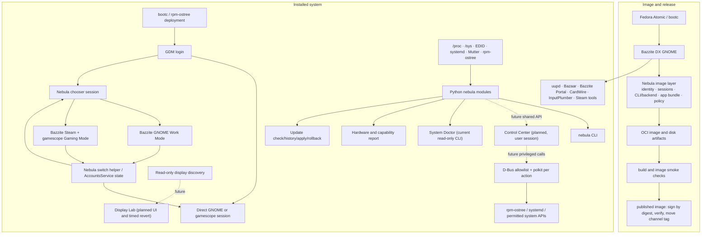

# Target and current architecture

This document describes both the implemented system and the blueprint target. “Current” labels code that exists in the repository at the time of the audit; “target” labels a proposed component. The GTK Control Center, Display Lab UI, Gaming Optimizer, benchmark lab, and Dev Hub are not shipped components.

## System map

## Components and boundaries

| Layer/component | Current responsibility | Interfaces and dependencies |
|---|---|---|
| **Base OS** | Fedora Atomic/bootc, systemd, SELinux and GNOME through Bazzite DX. Nebula builds from `ghcr.io/ublue-os/bazzite-dx-gnome:stable` by default. | `Containerfile:7-10`; bootc image build, rpm-ostree deployment/update model. Bazzite provides the kernel, graphics stack, Mesa/drivers, Steam, gamescope sessions, Proton, MangoHud, vkBasalt, CardWire, InputPlumber, uupd, Bazaar, Portal, and much of `ujust`. |
| **Gaming** | Current Nebula code renames and integrates Bazzite sessions, points GDM to the chooser for new users, and hooks Steam switching. The game platform itself is inherited. | Session IDs and `.desktop` entry commands from `/usr/share/wayland-sessions`; Gamescope/Steam; `/usr/lib/os-session-select`; `steamosctl`; `nebula-os-switch-side`; per-user mode state. No Nebula performance manager or compatibility database exists yet. |
| **Work** | Current GNOME session is the Bazzite DX GNOME desktop with Nebula branding, defaults, app bundle and a switch-to-gaming launcher. | GDM `gnome.desktop`, GNOME Shell settings, Bazaar/Bazzite Portal, Flatpak bundle. Developer tools such as Podman, Distrobox, VS Code and Homebrew are inherited rather than managed by a Nebula Dev Hub. |
| **Mode chooser** | `nebula-os-start` launches the GTK/libadwaita chooser under Cage; the wrapper reads the selected base session entry and starts GNOME or gamescope. Selection can persist or apply once. | CLI-free GUI helper; `nebula-os-chooser --result FILE [--message TEXT]`; `modes.py` stores last/next selection under per-user state; `busctl` talks to AccountsService for saved direct session selection; systemd user-manager environment is imported for child-session launch. The same login/logind session is reused. Its D-Bus, logind `Desktop`, portal and Bazzite recovery behavior still needs booted-image validation (`docs/BACKEND_GAMING_AUDIT.md`). |
| **Hardware Detection** | Python code collects system, GPU, display, driver and capability observations. It distinguishes hardware, driver, available, enabled and verified states rather than asserting generic “support.” | `nebula.gpu`, `hardware`, `display`, `capabilities`, `sysinfo`; `/sys`, `/proc`, EDID and optional graphics probes. `nebula hw --json` reports `nebula.hardware/v1`; `--no-probe` skips Vulkan/OpenGL/VA-API checks that may wake a GPU. |
| **System Doctor** | Twelve read-only checks and recommended commands; quick subset is included in status. It never applies fixes. | `nebula.doctor`; `nebula doctor --json` returns `nebula.doctor/v1`; `--report FILE` writes `nebula.doctor-report/v1`, with optional current-boot error logs. Current checks inspect SELinux, services, disk, GPUs, firmware, updates, network, audio, Bluetooth, controllers, Flatpaks and boot. |
| **Update and recovery** | `nebula update check|history|apply|rollback` inspects the current deployment and delegates changes to rpm-ostree. Bazzite/uupd handles automatic updates; bootc/rpm-ostree preserves deployments and rollback behavior. | JSON is supported by `check` and `history`; `apply` and `rollback` are confirmation-based text commands with optional `--yes`. Mutating operations use rpm-ostree’s polkit authentication. The full NebulaOS update and rollback journey is not yet VM/hardware validated. |
| **Display Lab** | A lower-level read-only display backend exists; the Lab UI, safe change workflow and timer are absent. | `nebula.display` reads connectors/EDID and Mutter state, with unit tests. The planned UI should use Mutter/GNOME’s display API and its confirmation/revert behavior; never expose modes that hardware/capability data says are unavailable. |
| **Gaming Optimizer** | Not implemented. | Target can coordinate Bazzite-supported power profile, scheduler and MangoHud interfaces, with per-game user settings. Profiles must be measured per device; no automatic tuning until rollback and compatibility are tested. |
| **Control Center** | Not implemented. Current CLI/backend are potential shared read APIs. | Blueprint target: Python GTK4/libadwaita app in the user session, never root. Use the existing `nebula` modules/data contract where useful. Any privileged actions must cross a narrow D-Bus interface with a fixed allowlist and polkit authorization per action. No generic command runner, arbitrary method arguments, or shell access. |

## Data and command contracts

### Current Python modules

`system_files/usr/lib/nebula-os/nebula/` contains:

- `cli.py`: parser, text output and JSON contracts.
- `sysinfo.py`: CPU, memory, storage, network, thermal, power and image information.
- `gpu.py`: GPU discovery, backend-specific metrics and optional probes.
- `display.py`: connectors, EDID parsing, Mutter state and display capabilities.
- `hardware.py`: combines GPU, display, hybrid graphics, gaming stack and notes.
- `capabilities.py`: five evidence levels (`hardware`, `driver`, `available`, `enabled`, `verified`).
- `doctor.py`: read-only diagnostic checks and report formatting.
- `updates.py`: rpm-ostree deployment parsing, remote update check, apply and rollback.
- `modes.py`: chooser state and gaming support checks.
- `util.py`: bounded subprocess execution and formatting helpers.

The current CLI is the supported contract. Preserve its command names, exit codes and schemas when adding a GUI or API:

| Command | Output/API behavior |
|---|---|
| `nebula status [--json]` | JSON schema `nebula.status/v1`; contains `time`, `os`, `uptime_seconds`, `cpu`, `memory`, `storage`, `network`, `gpus`, `power`, `updates`, and `health`. |
| `nebula hw [--json] [--no-probe]` | JSON schema `nebula.hardware/v1`; reports machine, storage, CPU, GPUs, displays, hybrid graphics, capability evidence, gaming stack and notes. |
| `nebula doctor [--json] [--report FILE] [--include-logs]` | JSON schema `nebula.doctor/v1` with `status` and `checks`; report file schema `nebula.doctor-report/v1`. The log option includes this boot’s error log; read it before sharing. |
| `nebula update check [--json]` | JSON object with update state/message and image data where available. |
| `nebula update history [--json]` | JSON deployment array. |
| `nebula update apply [--yes]`; `nebula update rollback [--yes]` | No `--json` flag. Confirmation and rpm-ostree/polkit path remain. |

Do not treat JSON fields as a stable schema for unversioned/raw rpm-ostree objects. New frontends should consume the documented `nebula.* /v1` schema only, handle missing/unknown values, and add contract tests before changing it.

### Privilege boundary and D-Bus

There is no Nebula Control Center D-Bus service or Nebula-specific polkit action implemented in the current tree. Current reads run as the logged-in user. The CLI’s update mutators call rpm-ostree, which requests authorization through its own polkit integration. Mode selection uses AccountsService for the user’s own session choice; `ujust` recipes that explicitly use `sudo` are separate administrative CLI flows.

For a future Control Center:

1. Keep the GTK process unprivileged in the user’s GNOME session.
2. Prefer read-only calls to the tested Python/CLI data layer.
3. For operations that need system privilege, expose only named, typed operations through a small system D-Bus service. Enforce the corresponding polkit action at the service boundary.
4. Do not accept executable names, command lines, arbitrary file paths, service names or unvalidated values from the UI. Do not use a root GUI, `pkexec` the app, or add a general “run command as root” method.
5. Keep confirmation, result/error and rollback behavior visible to the user. Persist only the minimum per-user state.

Whether update actions should continue through rpm-ostree’s existing polkit prompt or move behind a Nebula allowlisted service is an architecture decision for Phase 2; avoid two competing authorization paths.

## Bazzite reuse map

| Reused Bazzite / Universal Blue capability | NebulaOS responsibility |
|---|---|
| Fedora Atomic, bootc, rpm-ostree deployments, SELinux, systemd | Build a thin image layer, preserve deployment semantics and document a tested recovery route. |
| Kernel, firmware, Mesa, NVIDIA edition, graphics drivers | Report observed capability and validate each device; do not claim compatibility from package presence. |
| Steam, Proton, gamescope sessions, controller stack, InputPlumber, CardWire | Integrate the existing Gaming session; preserve the base hooks and verify the exact image’s behavior. |
| MangoHud and vkBasalt | Provide a restrained Nebula palette preset; do not imply the future Optimizer exists. |
| GNOME, GDM and Bazzite DX development tools | Make Work Mode branded and accessible; avoid replacing GNOME or duplicating the dev toolchain. |
| uupd and Bazzite recovery commands | Expose a clear Nebula status and tested recovery instructions; validate rollback for Nebula’s signed image identity. |
| Bazaar and Bazzite Portal | Curate a small Flatpak bundle and rows; do not build another general package store. |
| Bazzite `ujust`, `steamosctl` and Steam session selector | Keep compatible recipes/hooks and a narrowly scoped shim only when the base lacks its own implementation. |

## Operational constraints

- Keep the image small and retain the Bazzite DX base; build only where Nebula supplies a distinct integration or report.
- No AI features, hidden telemetry, silent repairs, or undocumented network calls.
- Preserve public CLI arguments, JSON schemas and exit behavior; version any incompatible data contract.
- Never present hardware detection or a passing unit test as a gaming, display, suspend, controller, or real-device guarantee.
- Any display or performance change must be validated, previewed, confirmed, verified and reversible. Display changes need a timed recovery path before broader profile support.
